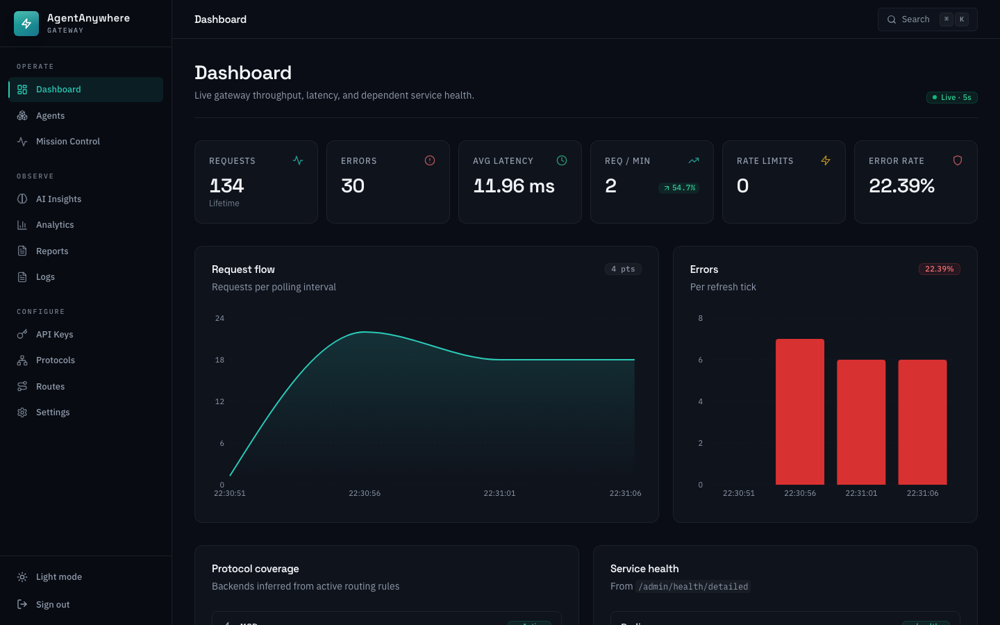
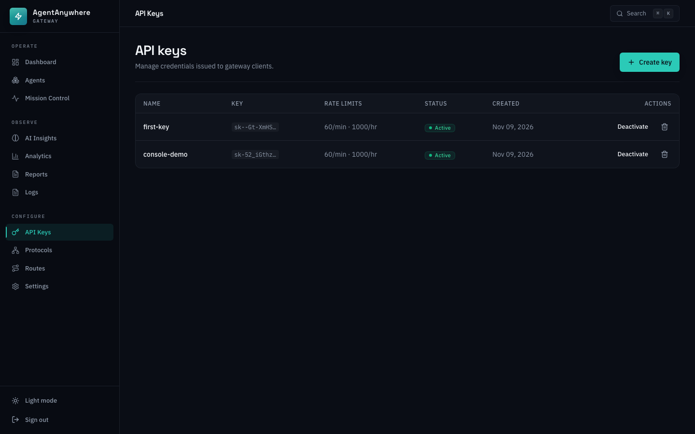
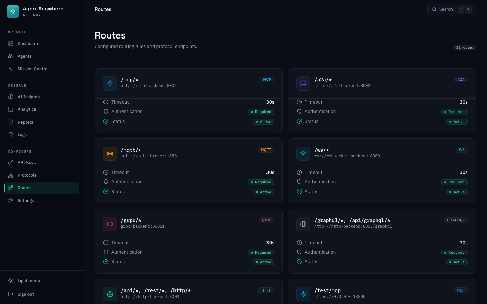
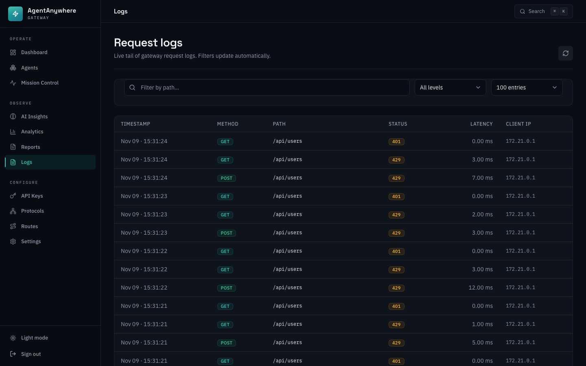
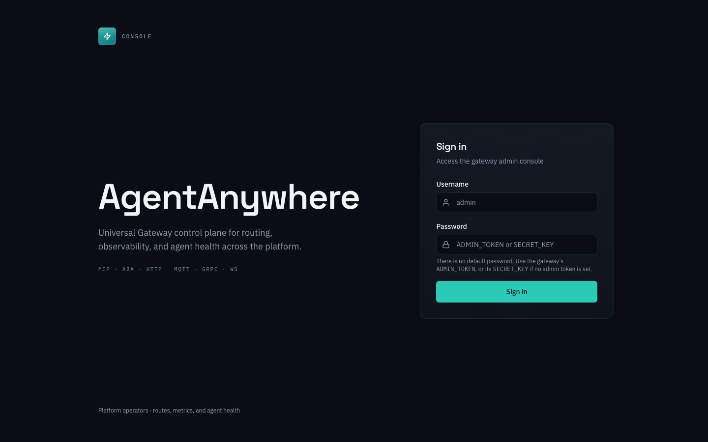

<picture>
  <source media="(prefers-color-scheme: dark)" srcset="docs/img/brand/agentanywhere-horizontal-dark.svg">
  
</picture>

# AgentAnywhere Universal Gateway: open-source API gateway for AI agents (MCP, A2A, AG-UI, ACP)

**AgentAnywhere Universal Gateway is an open-source (Apache-2.0) API gateway
for AI agents and the services they call.** It sits in front of MCP, A2A,
AG-UI, ACP, HTTP/REST, GraphQL and MQTT backends and gives them one place to
issue API keys, enforce rate limits and tenant quotas, route traffic, check
protocol messages and watch metrics, logs and traces, without changing the
services behind it. It is a Python (FastAPI) service you run yourself, with a
React admin console, a command-line tool and a Docker Compose file.

Several agent and tool services usually end up with several ways to sign in,
several sets of limits and several logs. When someone asks "which agent called
what, and who allowed it?", the answer should come from one place. That place
is the gateway.

| | |
|---|---|
| **What it is** | A self-hosted AI agent gateway: a reverse proxy that understands agent protocols |
| **What it does** | API keys (stored as hashes), per-key and per-tenant limits, path-prefix routing, circuit breakers, protocol checks, metrics, logs and traces |
| **Protocols** | MCP (Model Context Protocol), A2A (Agent2Agent), AG-UI, ACP, HTTP/REST, GraphQL, MQTT. WebSocket and gRPC pass-through are [not working yet](#what-it-does-not-do) |
| **Admin console** | React app: dashboard, API keys, routes, request logs, protocols, settings ([screenshots](#see-your-gateway)) |
| **Licence** | Apache-2.0 |
| **Requirements** | Docker with Compose, or Python 3.10 to 3.12. Redis and PostgreSQL are optional |
| **Install** | `docker compose --profile backends up -d --build` ([quick start](#quick-start)) |
| **Status** | Version 1.0.0, not yet released ([changelog](CHANGELOG.md), [known limitations](docs/known-limitations.md)) |
| **Maintainer** | [ShepHertz Technologies](https://gateway.agentanywhere.ai/) |

<p align="center">
  
</p>

[](https://github.com/agentanywhere/agentanywhere-universal-gateway/actions/workflows/ci.yml)
[](LICENSE)
[](pyproject.toml)

---

## Quick start

Pick one. Both end with the same first request.

### Option A: Docker Compose (the gateway, Redis, the console and sample backends)

You need Docker with the Compose plugin, `git`, `curl` and Python 3 (only to
generate the secrets). The first build takes a few minutes.

```bash
git clone https://github.com/agentanywhere/agentanywhere-universal-gateway.git
cd agentanywhere-universal-gateway
cp env.example .env
python3 scripts/generate_secret_key.py --update-env
echo "ADMIN_TOKEN=$(python3 scripts/generate_secret_key.py 2>/dev/null)" >> .env
docker compose --profile backends up -d --build
```

When `docker compose ps` shows the gateway as `healthy` (about 30 seconds after
the build), check it and make your first request:

```bash
curl -s http://127.0.0.1:8000/health
ADMIN=$(grep '^ADMIN_TOKEN=' .env | tail -n 1 | cut -d= -f2-)
API_KEY=$(curl -s -X POST "http://127.0.0.1:8000/admin/api-keys?name=first-key" \
  -H "Authorization: Bearer $ADMIN" | python3 -c 'import json,sys; print(json.load(sys.stdin)["key"])')
curl -s -X POST http://127.0.0.1:8000/api/users -H "X-API-Key: $API_KEY" \
  -H "Content-Type: application/json" -d '{"name": "Ada", "email": "ada@example.com"}'
```

Then open the admin console at <http://127.0.0.1:3001>, sign in as `admin` with
your `ADMIN_TOKEN`, and look at the request you just made.

If port 8000 is taken, add `PORT=18000` to `.env` and use that port in the
commands. Published ports listen on `127.0.0.1` only; see
[Deploy with Docker Compose](docs/how-to/deploy-with-docker-compose.md) before
you change that.

### Option B: Python (no Docker)

You need Python 3.10, 3.11 or 3.12, `git` and `curl`. Redis, PostgreSQL and
Docker are not needed. Most of the time goes into `pip install`.

```bash
git clone https://github.com/agentanywhere/agentanywhere-universal-gateway.git
cd agentanywhere-universal-gateway
python3 -m venv .venv && source .venv/bin/activate
pip install -r requirements.txt
cp env.example .env
python3 scripts/generate_secret_key.py --update-env
echo "ADMIN_TOKEN=$(python3 scripts/generate_secret_key.py 2>/dev/null)" >> .env
uvicorn app.main:app --port 8000
```

When the gateway starts it prints a banner on stderr: the health-check URL,
which credential opens the admin API, the supported protocols, the console and
documentation links, and the logging settings. It never shows a secret. Turn it
off with `STARTUP_BANNER=false`.

**Admin console (optional).** The console is a separate React app; plain
`uvicorn` does not serve it. In another terminal, with Node 20 (the version the Docker build uses):

```bash
cd admin-ui && npm ci && npm run dev
```

Open <http://127.0.0.1:3001> and sign in with the `ADMIN_TOKEN` from your
`.env`. The dev server proxies `/admin` and `/api` to `127.0.0.1:8000`. With
Docker Compose the console starts for you; see below.

In a second terminal, start the sample HTTP backend (port 8003, where
`HTTP_BACKEND_URL` in `env.example` points):

```bash
cd agentanywhere-universal-gateway && source .venv/bin/activate
python3 samples/backends/http/http_server.py
```

In a third terminal, create an API key and call the backend through the
gateway (the same commands as in option A, in the gateway directory):

```bash
cd agentanywhere-universal-gateway
ADMIN=$(grep '^ADMIN_TOKEN=' .env | tail -n 1 | cut -d= -f2-)
API_KEY=$(curl -s -X POST "http://127.0.0.1:8000/admin/api-keys?name=first-key" \
  -H "Authorization: Bearer $ADMIN" | python3 -c 'import json,sys; print(json.load(sys.stdin)["key"])')
curl -s -X POST http://127.0.0.1:8000/api/users -H "X-API-Key: $API_KEY" \
  -H "Content-Type: application/json" -d '{"name": "Ada", "email": "ada@example.com"}'
```

The console is a separate React app; plain `uvicorn` does not serve it. To see
it, open another terminal (Node 22) and run this from the repository directory,
the one that contains `admin-ui/`:

```bash
cd agentanywhere-universal-gateway/admin-ui
npm ci
npm run dev
```

Then open <http://127.0.0.1:3001> and sign in as `admin` with your `ADMIN_TOKEN`.
The gateway must be running on port 8000: the dev server proxies to it.

### What you should see

The first request returns the user the backend created:

```json
{"id": "user_1", "name": "Ada", "email": "ada@example.com", "metadata": null, "created_at": "2026-10-20T19:29:25.848555+00:00"}
```

Without the `X-API-Key` header the gateway answers `401` and the backend never
sees the request. Opening `http://127.0.0.1:8000/` in a browser shows that 401
page, which means the gateway is running: every route except the health and
readiness endpoints needs a key.

**Windows.** The commands assume Linux or macOS. On Windows use Git Bash (or
WSL) and use `python` where the commands say `python3` (`python3` on Windows
is the Microsoft Store shortcut and fails). Create the environment with
`py -3.12 -m venv .venv` and activate it with `source .venv/Scripts/activate`
in Git Bash, `.venv\Scripts\Activate.ps1` in PowerShell, or
`.venv\Scripts\activate.bat` in cmd.

**Use `127.0.0.1`, not `localhost`.** The server listens on IPv4 only. On some
machines (macOS in particular) `localhost` resolves to the IPv6 address first
and the connection fails.

The [getting-started tutorial](docs/tutorials/getting-started.md) walks through
the same steps with explanations.

---

## See your gateway

The admin console shows what the gateway is doing: live throughput, latency and
error rate; every API key; every route and its backend; and a live tail of the
request log. It is served at <http://127.0.0.1:3001> with Docker Compose, or by
`npm run dev` in `admin-ui/`.



| | |
|---|---|
|  |  |
| **API keys.** Create, deactivate and delete keys; each shows its limits. The full key is shown once, when you create it. | **Routes.** Every path prefix, the protocol it carries and the backend it goes to. |
|  |  |
| **Request logs.** A live tail with filters; refused (`401`) and limited (`429`) requests stand out. | **Sign-in.** Use `ADMIN_TOKEN`. There is no default password. |

It also has pages for agents, mission control, analytics, AI insights, reports,
protocol testing and settings. It talks to the gateway's own admin API, so
anything you can click you can also script ([HTTP API reference](docs/reference/http-api.md)).

---

## Guides: how do I...?

Every how-to is one task with the commands to do it.

| I want to... | Read |
|---|---|
| Run it with Docker Compose, PostgreSQL, nginx or monitoring | [Deploy with Docker Compose](docs/how-to/deploy-with-docker-compose.md) |
| Create, rotate and revoke API keys | [Manage API keys](docs/how-to/manage-api-keys.md) |
| Send each kind of traffic to the right backend | [Configure routes and backends](docs/how-to/configure-routes-and-backends.md) |
| Cap requests per key and per customer | [Set rate limits and tenant quotas](docs/how-to/rate-limits-and-quotas.md) |
| Serve HTTPS and keep operational endpoints private | [Run behind nginx with TLS](docs/how-to/run-behind-nginx-tls.md) |
| Harden it before real traffic | [Secure the gateway for production](docs/how-to/secure-for-production.md) |
| Watch health, metrics, logs and traces | [Monitor the gateway](docs/how-to/monitor.md) |
| Get notified of rate-limit and circuit-breaker events | [Send events to a webhook](docs/how-to/configure-webhooks.md) |
| Extend it with Python | [Write a plugin](docs/how-to/write-a-plugin.md) |
| Keep and recover keys, tenants and routes | [Back up and restore](docs/how-to/back-up-and-restore.md) |
| Move to a new release | [Upgrade the gateway](docs/how-to/upgrade.md) |
| Fix a 401, 403, 404, 502 or 429 | [Troubleshoot request errors](docs/how-to/troubleshoot-401-502-429.md) |
| Measure latency and throughput | [Test performance](docs/how-to/performance-testing.md) |
| Run the test suite | [Run the tests](docs/how-to/run-the-tests.md) |

**Learn:** [your first authenticated request](docs/tutorials/getting-started.md),
[two backends with limits, quotas and metrics](docs/tutorials/two-backends-end-to-end.md).
**Look up:** [configuration](docs/reference/configuration.md), [HTTP API](docs/reference/http-api.md),
[CLI](docs/reference/cli.md), [errors](docs/reference/errors.md), [metrics](docs/reference/metrics.md),
[database](docs/reference/database.md). **Understand:** [architecture](docs/explanation/architecture.md),
[protocol support](docs/explanation/protocol-support.md), [security model](docs/explanation/security-model.md),
[design decisions](docs/explanation/design-decisions.md), [glossary](docs/glossary.md).
The full list is the [documentation map](docs/README.md).

---

## What you get

- **API keys** stored as hashes and shown once, with per-key limits per
  minute and per hour, optional expiry and path scope, created and revoked
  through an admin API (revocation takes effect on the next request).
- **Tenant quotas** shared by groups of keys, with usage counters.
- **Routing** by path prefix to one backend per protocol, plus routes added at
  run time, a circuit breaker per backend, and Server-Sent Events streaming for
  AG-UI, ACP and A2A.
- **Protocol checks** for MCP (JSON-RPC shape, size, method lists, a simple
  prompt-injection pattern filter), A2A, ACP and AG-UI bodies.
- **Observability:** Prometheus metrics, JSON logs, a request log table,
  health and readiness endpoints, W3C trace context and optional OTLP export.
- **Operations:** an admin API, a React admin console, a command-line tool,
  plugins, webhooks, IP rules and policies, a Dockerfile, a Compose file and
  an nginx TLS configuration.

What works for each protocol is in the
[protocol support matrix](docs/explanation/protocol-support.md).

---

## Frequently asked questions

### What is an AI agent gateway?

A gateway that sits between AI agents and the tools, models and services they
call. Instead of every service doing its own sign-in, limiting and logging, the
gateway does it once: it checks the API key, applies limits and policy, checks
the protocol message, forwards the request and records what happened.

### How is this different from a reverse proxy such as nginx?

A reverse proxy forwards requests. This gateway also issues and checks API
keys, applies per-key and per-tenant limits, understands agent protocols well
enough to validate an MCP, A2A, ACP or AG-UI message, and reports metrics per
route. It is built to be put in front of agent and tool services.

### Which protocols does it support?

MCP (HTTP transport), A2A (HTTP and Server-Sent Events), AG-UI, ACP,
HTTP/REST, GraphQL and MQTT. The WebSocket route closes every connection and
the gRPC bridge answers `"status": "unsupported"`. Details and the tests behind
each row are in the [protocol support matrix](docs/explanation/protocol-support.md).

### Does it support the Model Context Protocol (MCP)?

Yes, over the HTTP transport. Requests under `/mcp/` are authenticated and
rate limited, checked for JSON-RPC shape, size, allowed methods and a simple
prompt-injection pattern filter, and forwarded to `MCP_BACKEND_URL`.

### Do I need Redis or PostgreSQL?

No. Without Redis, rate-limit counters are kept in memory, which is correct for
one process; use Redis when you run several processes or replicas. SQLite is
the default database; the Compose file can start PostgreSQL instead.

### Is it ready for production?

Version 1.0.0 is not yet released. It has an automated test suite that runs on
every push, a Dockerfile, a Compose file and an nginx configuration. Some
settings look like controls but are not enforced yet, and `SECRET_KEY` remains
a break-glass API key. Read the [known limitations](docs/known-limitations.md)
and work through [Secure the gateway for production](docs/how-to/secure-for-production.md)
before you decide.

### How fast is it?

There are no published figures: they depend on your hardware, database and
worker count. [Test performance](docs/how-to/performance-testing.md) shows how to
measure your own set-up with the bundled load tester.

### How do I report a security problem?

Privately, not in a public issue. See [SECURITY.md](SECURITY.md).

More questions are answered in the [FAQ](docs/faq.md).

---

## What it does not do

- **WebSocket and gRPC pass-through do not work.** The WebSocket route closes
  every connection, and the gRPC bridge answers `"status": "unsupported"`.
- **Some settings are not enforced yet:** admin roles, per-protocol rate
  limits, the policy `rate_limit` action and tenant `requests_per_day`.
- **`SECRET_KEY` is a break-glass credential** accepted as an API key on every
  data-plane route (and on the admin API while `ADMIN_TOKEN` is empty).
- **Defaults to review:** `/metrics` and `/health/detailed` need no credential
  unless `OPS_ENDPOINTS_REQUIRE_ADMIN=true`; nginx limits them to private
  addresses, but the Compose file publishes port 8000 directly.
- **Keys created by earlier builds** stay in plaintext in the database until
  they are next used.
- It does not terminate TLS, ship Kubernetes manifests, or publish benchmarks.

Every item, with its workaround: [known limitations](docs/known-limitations.md).

## Who is it for?

- **For** teams that run several agent or API services and want one place to
  issue keys, apply limits and watch traffic, without changing the services.
- **Not for** anyone who needs WebSocket or gRPC pass-through, role-based
  admin access, per-protocol rate limits or published performance figures.

## Contributing, support and security

- [CONTRIBUTING.md](CONTRIBUTING.md): how to contribute, with a tour of the
  codebase and how to run the tests.
- [Support](docs/support.md): where to ask and what to include.
- [SECURITY.md](SECURITY.md): report vulnerabilities privately, not in a
  public issue.
- [Code of conduct](CODE_OF_CONDUCT.md).

## Licence

Apache License 2.0. See [LICENSE](LICENSE) and [NOTICE](NOTICE).

Copyright 2026 ShepHertz Technologies Pvt. Ltd.
