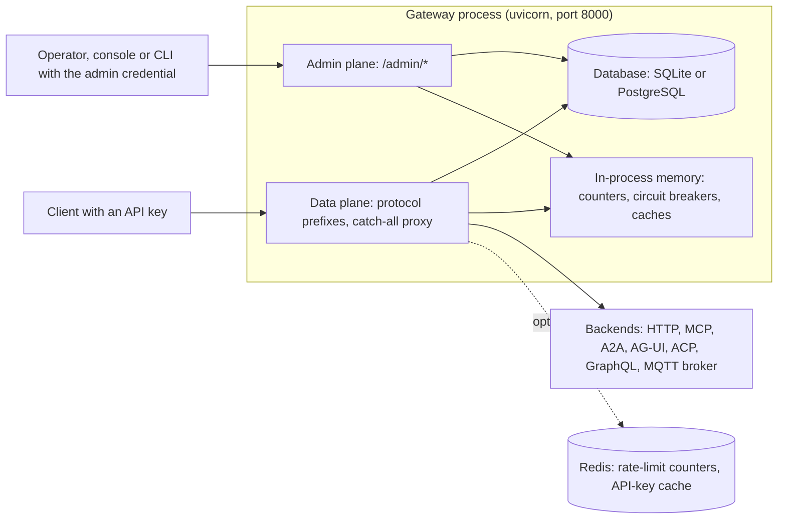
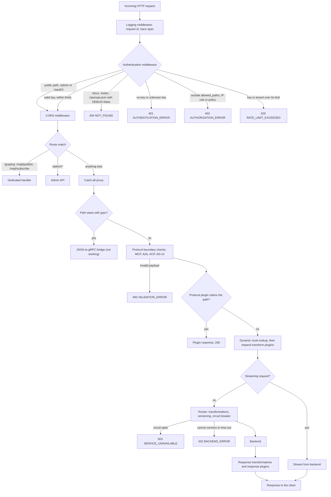

# Architecture

This page explains how a request moves through AgentAnywhere Universal Gateway,
how the admin plane differs from the data plane, and where state is kept. It
describes the code in `app/main.py`, `app/middleware/`, `app/routing.py` and
`admin/`.

## Contents

- [One process, two planes](#one-process-two-planes)
- [The path of a data-plane request](#the-path-of-a-data-plane-request)
- [Where the work happens](#where-the-work-happens)
- [Special routes](#special-routes)
- [The admin plane](#the-admin-plane)
- [Where state lives](#where-state-lives)
- [Start-up and shutdown](#start-up-and-shutdown)

## One process, two planes

The gateway is one FastAPI application, served by uvicorn. It has two kinds of
routes:

- The **data plane** is everything your clients call: the protocol prefixes
  (`/mcp/*`, `/a2a/*`, `/api/*` and the others), `/graphql`, `/mqtt/*` and a
  catch-all route that proxies any other path. Callers authenticate with an
  **API key**.
- The **admin plane** is everything under `/admin`. The admin console and the
  command-line tool use it to manage keys, tenants, routes and settings.
  Callers authenticate with the **admin credential**.

Both planes run in the same process, on the same port, and share the same
database.

## The path of a data-plane request

Three HTTP middlewares wrap every request. Starlette runs the one registered
last first, so the order is:

1. **Logging middleware** (`logging_middleware` in `app/main.py`). It assigns
   the request id, handles W3C `traceparent`, opens a trace span, and after the
   response records metrics, the access log line, tenant usage and a
   `request_logs` row.
2. **Authentication middleware** (`auth_middleware_handler`). It lets
   `OPTIONS`, the health and metrics paths, `/admin/*` and `/oauth2/*`
   through (`/metrics` and `/health/detailed` check the admin credential
   themselves when `OPS_ENDPOINTS_REQUIRE_ADMIN=true`). It answers `/docs`,
   `/redoc` and `/openapi.json` with 404 unless `DEBUG=true`. For everything
   else it runs auth-provider plugins, then validates the API key, checks its
   `allowed_paths`, applies IP rules and policies, and checks the per-key rate
   limit and the tenant quota. A failure is answered here, with 401, 403 or
   429, and the request goes no further.
3. **CORS middleware** (Starlette's `CORSMiddleware`).

Because logging runs outside authentication, a rejected request still gets an
`X-Request-ID`, is counted in metrics (with the path label reduced to its
first segment) and is written to `request_logs` with its error code. It is not
counted in tenant usage.

After the middlewares, FastAPI dispatches to a route. Most traffic reaches the
catch-all proxy, `gateway_proxy`:

## Where the work happens

| Step | Code | What it does |
|---|---|---|
| Find the key | `AuthMiddleware._get_api_key_from_header` (`app/middleware/auth.py`) | Reads the header named by `API_KEY_HEADER` (default `X-API-Key`), then `Authorization: Bearer`. |
| Validate the key | `AuthMiddleware._validate_api_key` | Redis cache first (if enabled; keyed by the key's hash), then the database by SHA-256 hash; checks expiry and `is_active`; finally accepts `SECRET_KEY` if it is not the placeholder. |
| Path scope | `path_is_allowed` (`app/middleware/auth.py`) | A key with `allowed_paths` gets 403 for other paths. |
| Client address | `client_ip` (`app/client_ip.py`) | The connection's address, or `X-Forwarded-For` read from the right when the connection comes from `TRUSTED_PROXIES`. |
| OAuth2 fallback | `AuthMiddleware._validate_oauth2_token` | A bearer token issued by the gateway's own OAuth2 endpoints is accepted, with the default limits. |
| Governance | `AuthMiddleware._enforce_governance` | IP allow and deny rules, then the policy engine (`app/governance.py`). |
| Per-key limit | `RateLimiter.check_rate_limit` (`app/middleware/rate_limit.py`) | Fixed one-minute and one-hour windows, per key, in Redis or in memory. |
| Tenant quota | `tenant_service.check_quota` (`app/tenant.py`) | Minute and hour quotas, counted in the `tenant_usage` table. |
| Protocol checks | `app/tier1_mcp.py`, `app/tier1_a2a.py`, `app/tier2_acp.py`, `app/tier2_ag_ui.py` | Validate payloads for those protocols; for MCP, JSON-RPC shape, body size, method lists and prompt-injection patterns. |
| Choose a backend | `route_registry.match` (`app/route_registry.py`), then `Router._get_backend_url` (`app/routing.py`) | A dynamic route wins; otherwise the path prefix decides. |
| Forward | `Router.route_request` / `Router.start_upstream_stream` | One shared `httpx.AsyncClient`; per-backend circuit breaker; `DEFAULT_TIMEOUT` seconds, or the streaming timeouts. |

The gateway forwards the caller's headers to the backend, apart from headers
starting with `X-Gateway-`. It adds `X-Protocol` and a `traceparent`, and sets
`X-Forwarded-For` to the incoming value of that header (empty if there was
none). For AG-UI and ACP it strips the `/agui` or `/acp` prefix; for the other
protocols the backend sees the full path.

## Special routes

- `/graphql` (POST) is handled by `GraphQLHandler`, which posts the query to
  `GRAPHQL_BACKEND_URL`.
- `/mqtt/publish` and `/mqtt/subscribe` use a paho-mqtt client connected at
  start-up to `MQTT_BROKER_URL`.
- `/ws/{path}` is a WebSocket route outside the HTTP middleware. It does not
  work as shipped; see the [protocol support matrix](protocol-support.md).
- `/agents/<slug>/...` is the optional **agent edge**: a path-prefix reverse
  proxy for HTTP and WebSocket that forwards to a per-slug upstream and applies
  no gateway credential. It is off unless `AGENT_EDGE_ENABLED=true` or agent
  routes exist in the database.
- `/oauth2/*` lets clients obtain tokens from OAuth2 providers registered
  through the admin API.

## The admin plane

The admin routers are `admin/api.py` and `admin/agents_api.py`, both mounted
under `/admin`. Every admin endpoint except `/admin/health`,
`/admin/auth/config` and `/admin/auth/login` depends on `verify_admin_token`,
which accepts:

1. An OpenID Connect access token, when `IDA_ISSUER` is set (`app/ida_auth.py`).
2. `ADMIN_TOKEN`.
3. `SECRET_KEY`, when it is not the shipped placeholder and `ADMIN_TOKEN` is
   empty (or `ADMIN_ACCEPT_SECRET_KEY=true`).

The admin console (`admin-ui/`) is a separate React application. It talks to
the admin API on its own origin, so it needs a proxy that forwards `/admin` to
the gateway: the console's nginx image does this on the Compose network, and
the Vite development server does it on your machine. The CLI (`app/cli/`) uses
the same admin API over HTTP.

The [HTTP endpoint list](../reference/http-endpoints.md) has every admin
operation.

## Where state lives

| State | Where | Shared between processes? |
|---|---|---|
| API keys, routes, tenants and tenant usage, request logs, settings profiles, governance policies, IP rules, admin roles and audit log, OpenAPI registrations, agent registry | Database (`DATABASE_URL`) | Yes, if every process uses the same database server. |
| Per-key rate-limit counters | Redis database from `RATE_LIMIT_REDIS_URL`, or process memory | Only with Redis. |
| API-key cache (at most 300 seconds, dropped on delete or disable) | Redis database from `REDIS_URL`, when `REDIS_ENABLED=true` | Yes. |
| Circuit breakers | Process memory | No. |
| Webhooks, transformation rules, API versions, OAuth2 providers and tokens, log exporters added at run time | Process memory | No. Lost on restart. |
| Dynamic route table | Database, with an in-memory copy refreshed every `DYNAMIC_ROUTES_REFRESH_SECONDS` | Yes, after the refresh. |
| Traces, SLO tracker, analytics history | Process memory | No. |

[Design decisions and trade-offs](design-decisions.md) explains what this
means when you run more than one worker.

## Start-up and shutdown

Importing `app.main` reads settings, creates the protocol handlers (and
connects the MQTT client), and builds the app. The lifespan handler then:

1. creates any missing tables (`init_db()`, which runs `create_all`);
2. loads OpenAPI registrations, governance policies and IP rules;
3. configures tracing, email and Slack notifications and log exporters;
4. loads tenants into memory;
5. loads plugins and runs their `startup` hooks;
6. loads the agent registry and the dynamic routes, and starts their refresh
   tasks and the agent monitor.

Failures in steps 2 to 6 are logged as warnings and do not stop the gateway.
On shutdown it cancels the background tasks, runs plugin `shutdown` hooks and
closes the HTTP client, exporters, protocol handlers and database engine.
