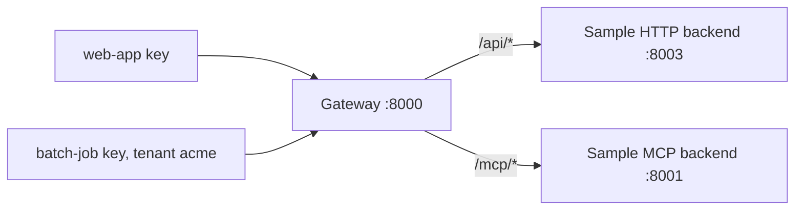

# Tutorial: two backends, limits, quotas and metrics

In this tutorial you put two sample backends behind the gateway, one HTTP/REST
and one MCP, and give two clients their own API keys. You then see a per-key
rate limit and a tenant quota take effect, look at the traffic in the admin
API and the admin console, and read the gateway's Prometheus metrics.

It builds on [your first authenticated request](getting-started.md). Do that
tutorial first: this one assumes the repository is installed, `.env` exists
with a real `SECRET_KEY` and `ADMIN_TOKEN`, and the gateway runs on port 8000.

## Contents

- [The scenario](#the-scenario)
- [1. Start the two backends](#1-start-the-two-backends)
- [2. Give each client its own key](#2-give-each-client-its-own-key)
- [3. Call both backends through the gateway](#3-call-both-backends-through-the-gateway)
- [4. Hit the per-key rate limit](#4-hit-the-per-key-rate-limit)
- [5. Put a client under a tenant quota](#5-put-a-client-under-a-tenant-quota)
- [6. Look at the traffic](#6-look-at-the-traffic)
- [7. Read the Prometheus metrics](#7-read-the-prometheus-metrics)
- [8. Clean up](#8-clean-up)
- [How these outputs were produced](#how-these-outputs-were-produced)

## The scenario

A web application and a batch job both use two services: a REST service that
manages users, and an MCP service that answers queries. You want each client
to have its own credential, the web application to be held to 5 requests a
minute, and the batch job to belong to a customer account ("Acme Corp") with a
quota of 3 requests a minute.



## 1. Start the two backends

Keep the gateway running in its terminal. In a second terminal, start the HTTP
backend if it is not still running from the first tutorial:

```bash
cd agentanywhere-universal-gateway
source .venv/bin/activate
python3 samples/backends/http/http_server.py
```

In a third terminal, start the MCP backend:

```bash
cd agentanywhere-universal-gateway
source .venv/bin/activate
python3 samples/backends/mcp/mcp_server.py
```

It listens on port 8001, which is `MCP_BACKEND_URL` in `env.example` and the
built-in default. The gateway forwards `/mcp/*` to it.

**Note.** The sample MCP backend is a small REST service with an MCP-like
`/mcp/query` endpoint, not a full MCP server. The gateway proxies whatever is
under `/mcp/*`. For JSON-RPC bodies it also applies the MCP boundary checks,
described in the [protocol support matrix](../explanation/protocol-support.md).

## 2. Give each client its own key

Open a fourth terminal for your requests:

```bash
cd agentanywhere-universal-gateway
ADMIN=$(grep '^ADMIN_TOKEN=' .env | tail -n 1 | cut -d= -f2-)
curl -s -X POST "http://localhost:8000/admin/api-keys?name=web-app&rate_limit_per_minute=5" \
  -H "Authorization: Bearer $ADMIN"
curl -s -X POST "http://localhost:8000/admin/api-keys?name=batch-job&rate_limit_per_minute=100" \
  -H "Authorization: Bearer $ADMIN"
```

Each response looks like this (your ids and keys differ):

```json
{
  "id": "7b60780a-137a-4abb-90b5-d7f32142fbc9",
  "name": "batch-job",
  "key": "sk-Fgx9WSn9X-WvQ6CNvOBuV98swkjM5pV-vOswbTXWehk",
  "rate_limit_per_minute": 100,
  "rate_limit_per_hour": 1000,
  "is_active": true,
  "created_at": "2026-10-20T17:36:55.400521",
  "expires_at": null,
  "allowed_paths": []
}
```

Save the two keys and the batch job's id:

```bash
WEB_KEY=paste-the-web-app-key
BATCH_KEY=paste-the-batch-job-key
BATCH_ID=paste-the-batch-job-id
```

## 3. Call both backends through the gateway

The MCP backend, with the web application's key:

```bash
curl -s -X POST http://localhost:8000/mcp/query \
  -H "X-API-Key: $WEB_KEY" -H "Content-Type: application/json" \
  -d '{"query": "What is on my calendar?", "context": {"user_id": "ada"}}'
```

```json
{
  "response": "MCP Response: What is on my calendar? (User: ada, Context: {'user_id': 'ada'})",
  "context": {
    "user_id": "ada"
  },
  "metadata": {
    "processed_at": "2025-12-03T10:00:00Z",
    "user_id": "ada",
    "query_length": 23
  }
}
```

The `processed_at` value is a fixed string in the sample backend.

The HTTP backend, with the same key:

```bash
curl -s http://localhost:8000/api/users -H "X-API-Key: $WEB_KEY"
```

```json
[
  {
    "id": "user_1",
    "name": "Ada",
    "email": "ada@example.com",
    "metadata": null
  }
]
```

You see the user you created in the first tutorial, because the sample backend
keeps users in memory for as long as it runs. If you restarted it, the list is
empty.

## 4. Hit the per-key rate limit

The web application's key allows 5 requests a minute, and it has used 2. Send
six more:

```bash
for i in 1 2 3 4 5 6; do
  curl -s -o /dev/null -w "%{http_code}\n" http://localhost:8000/api/users -H "X-API-Key: $WEB_KEY"
done
```

```text
200
200
200
429
429
429
```

The limit counts every request made with the key in the window, whichever
backend it went to. The body of a 429 says which limit was hit, and the
response carries `Retry-After: 60`:

```json
{
  "error": "RATE_LIMIT_EXCEEDED",
  "message": "Rate limit exceeded: 5 requests per minute",
  "request_id": null,
  "timestamp": "2026-10-20T17:36:55.466797",
  "details": {
    "limit": 5,
    "window": "minute",
    "retry_after": 60
  }
}
```

The window is fixed: it starts with the first request and lasts 60 seconds.
Wait a minute and the key works again.

## 5. Put a client under a tenant quota

A **tenant** groups API keys under one quota. Create one for Acme Corp with
a limit of 3 requests a minute:

```bash
curl -s -X POST http://localhost:8000/admin/tenants \
  -H "Authorization: Bearer $ADMIN" -H "Content-Type: application/json" \
  -d '{"tenant_id": "acme", "name": "Acme Corp", "quota": {"requests_per_minute": 3}}'
```

```json
{
  "tenant_id": "acme",
  "name": "Acme Corp",
  "description": null,
  "config": {},
  "quota": {
    "requests_per_minute": 3,
    "requests_per_hour": 10000,
    "requests_per_day": 100000,
    "storage_mb": 1000
  },
  "is_active": true,
  "created_at": "2026-10-20T17:36:55.469382",
  "updated_at": "2026-10-20T17:36:55.469386"
}
```

The values you did not set are the defaults. Only the minute and hour quotas
are enforced; see [known limitations](../known-limitations.md#several-limit-settings-are-accepted-but-not-enforced).

Associate the batch job's key with the tenant. The endpoint needs both the id
and the key itself:

```bash
curl -s -X POST http://localhost:8000/admin/tenants/acme/associate-api-key \
  -H "Authorization: Bearer $ADMIN" -H "Content-Type: application/json" \
  -d "{\"api_key_id\": \"$BATCH_ID\", \"api_key\": \"$BATCH_KEY\"}"
```

```json
{
  "tenant_id": "acme",
  "api_key_id": "7b60780a-137a-4abb-90b5-d7f32142fbc9",
  "api_key": "sk-Fgx9W...",
  "message": "API key associated"
}
```

The batch job's own limit is 100 a minute, but the tenant's is 3:

```bash
for i in 1 2 3 4; do
  curl -s -o /dev/null -w "%{http_code}\n" http://localhost:8000/api/users -H "X-API-Key: $BATCH_KEY"
done
```

```text
200
200
200
429
```

This 429 names the tenant and its quota:

```json
{
  "error": "RATE_LIMIT_EXCEEDED",
  "message": "Rate limit exceeded: 3 requests per minute",
  "request_id": null,
  "timestamp": "2026-10-20T17:36:56.138727",
  "details": {
    "limit": 3,
    "window": "minute",
    "retry_after": 60,
    "tenant_id": "acme",
    "quota": {
      "requests_per_minute": 3,
      "requests_per_hour": 10000,
      "requests_per_day": 100000,
      "storage_mb": 1000
    }
  }
}
```

Tenant usage is written to the database after each response, so a burst of
parallel requests can pass the quota by a few before the count catches up.

## 6. Look at the traffic

### With the admin API

The tenant's usage counters:

```bash
curl -s "http://localhost:8000/admin/tenants/acme/usage?window=minute&lookback=5" \
  -H "Authorization: Bearer $ADMIN"
```

```json
{
  "tenant_id": "acme",
  "current": {
    "minute": {"request_count": 3, "error_count": 0, "bytes_in": 0, "bytes_out": 216},
    "hour": {"request_count": 3, "error_count": 0, "bytes_in": 0, "bytes_out": 216},
    "day": {"request_count": 3, "error_count": 0, "bytes_in": 0, "bytes_out": 216}
  },
  "history": [
    {"window": "minute", "window_start": "2026-10-20T17:36:00", "request_count": 3, "error_count": 0, "bytes_in": 0, "bytes_out": 216}
  ]
}
```

The rejected fourth request is not in the count.

The most recent request log rows:

```bash
curl -s "http://localhost:8000/admin/logs?limit=2" -H "Authorization: Bearer $ADMIN"
```

Each row has the method, path, status code, response time and client address.
Requests that the gateway rejected with 401 or 429 are not logged; see
[known limitations](../known-limitations.md#rejected-requests-are-not-counted).

### With the admin console

The console is a React application in `admin-ui/`. To run it against your
local gateway you need Node.js (the console's Dockerfile builds with Node 20):

```bash
cd agentanywhere-universal-gateway/admin-ui
npm ci
npm run dev
```

The Vite development server listens on <http://localhost:3001> and forwards
`/admin` and `/api` to `localhost:8000`. Sign in with the user name `admin`
and your `ADMIN_TOKEN` as the password. The API Keys page lists the three keys
you created, with their limits.

**Warning.** The console's delete and enable/disable buttons for API keys do
not work: they answer 404. Use the admin API to revoke keys (next section and
[known limitations](../known-limitations.md#key-ids-are-only-shown-once-and-the-console-cannot-revoke-keys)).

With Docker Compose the console is built and served on port 3001 for you; see
[Deploy with Docker Compose](../how-to/deploy-with-docker-compose.md).

## 7. Read the Prometheus metrics

The gateway serves Prometheus metrics at `/metrics`, without a credential:

```bash
curl -s http://localhost:8000/metrics | grep -E '^gateway_(red_)?requests_total\{' | grep -E '/api/users|/mcp/query'
```

```text
gateway_requests_total{method="POST",path="/api/users",protocol="http",status_code="200"} 1.0
gateway_requests_total{method="GET",path="/api/users",protocol="http",status_code="200"} 8.0
gateway_requests_total{method="POST",path="/mcp/query",protocol="mcp",status_code="200"} 1.0
gateway_red_requests_total{method="POST",protocol="http",route="/api/users",status_class="2xx",tenant="_"} 1.0
gateway_red_requests_total{method="GET",protocol="http",route="/api/users",status_class="2xx",tenant="_"} 5.0
gateway_red_requests_total{method="POST",protocol="http",route="/mcp/query",status_class="2xx",tenant="_"} 1.0
gateway_red_requests_total{method="GET",protocol="http",route="/api/users",status_class="2xx",tenant="acme"} 3.0
```

Read it like this:

- `gateway_requests_total` counts by raw path and status code since the
  gateway started. If you ran the first tutorial against the same gateway
  process, the eight successful `GET /api/users` are one from that tutorial,
  four from the web application and three from the batch job, and the
  `POST /api/users` is the user you created there.
- `gateway_red_requests_total` uses a normalised route and a tenant label,
  so you can see the three requests that counted against Acme's quota.
- The four 429 responses (three for the web application, one for the batch
  job) are in neither metric, because rejected requests are
  answered before metrics are recorded.

To collect the metrics over time, point a Prometheus server at the gateway.
For a gateway on your own machine, a minimal configuration is:

```yaml
scrape_configs:
  - job_name: gateway
    static_configs:
      - targets: ["localhost:8000"]
```

The repository's `prometheus.yml` scrapes `gateway:8000` instead, which is the
gateway's name on the Docker Compose network (`docker compose --profile
monitoring up -d`). Every metric is described in the
[metrics reference](../reference/metrics.md).

## 8. Clean up

Revoke the two keys by id. You saved the batch job's id; the web
application's id was in its creation response.

```bash
curl -s -X DELETE "http://localhost:8000/admin/api-keys/$BATCH_ID" -H "Authorization: Bearer $ADMIN"
```

```json
{"message": "API key deleted"}
```

Delete the tenant:

```bash
curl -s -X DELETE http://localhost:8000/admin/tenants/acme -H "Authorization: Bearer $ADMIN"
```

Stop the backends and the gateway with Ctrl-C. The keys, tenant and request
logs stay in `gateway.db` until you delete it.

## How these outputs were produced

The outputs come from replaying the same requests, in the same order, against
the gateway in process with FastAPI's test client, with a `.env` built from
`env.example` as in the first tutorial and both sample backends mounted in the
same process. Timestamps, ids and keys differ on every run. The admin console
and Prometheus steps were not run for this page; they are described from
`admin-ui/vite.config.ts`, `admin-ui/Dockerfile`, `prometheus.yml` and
`docker-compose.yml`.

## Next

- [Set rate limits and tenant quotas](../how-to/rate-limits-and-quotas.md)
- [Monitor the gateway](../how-to/monitor.md)
- [Configure routes and backends](../how-to/configure-routes-and-backends.md)
